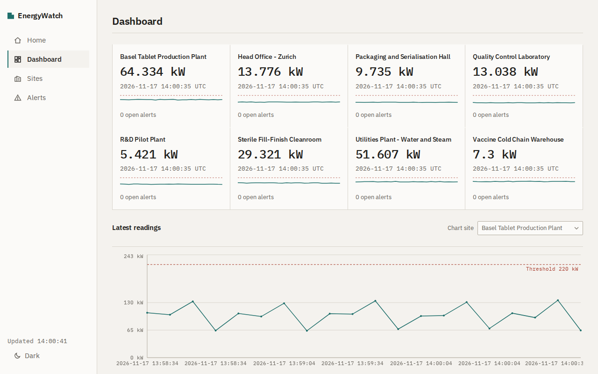
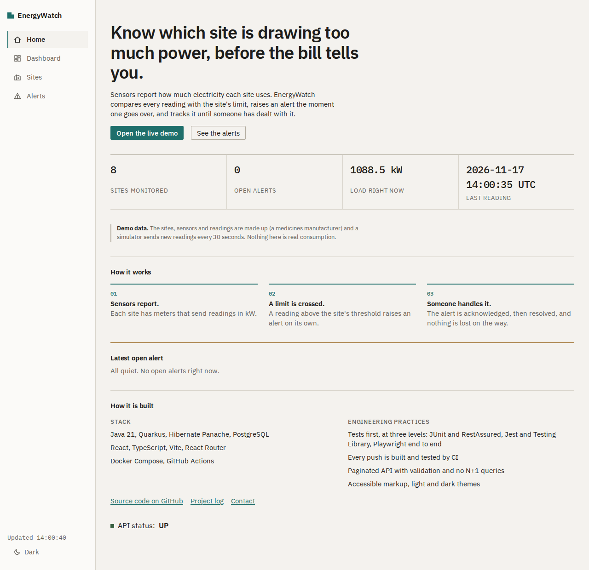
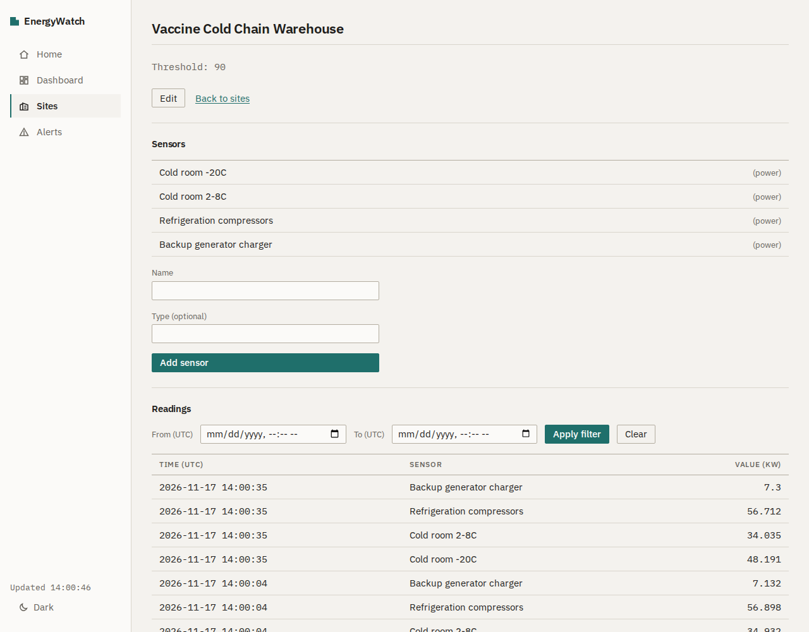
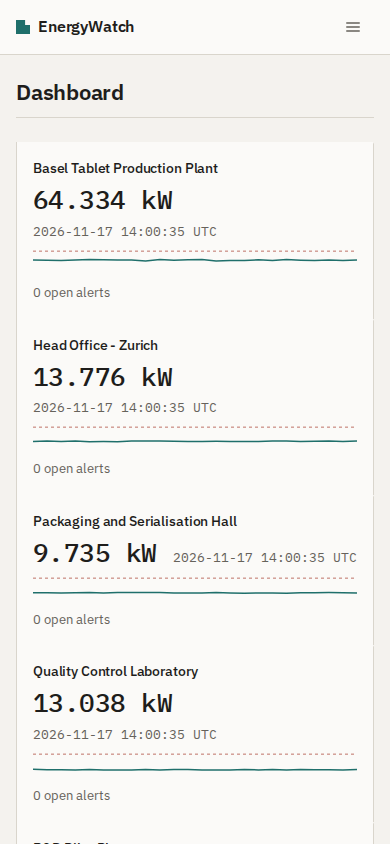
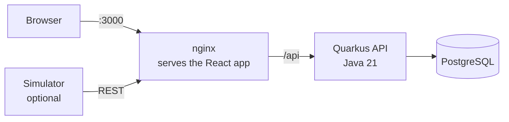

# EnergyWatch

[](https://github.com/Aswyngam-A/energy-monitoring-app/actions/workflows/ci.yml)

Energy monitoring for a company with several sites. Sensors send power readings, the API compares every
reading with its site's limit, raises an **alert** the moment one goes over, and tracks that alert until
someone has dealt with it. A React dashboard shows what is happening, live.

The repository ships with a made-up **medicines manufacturer** as demo data (a tablet plant, a vaccine
cold chain, a sterile cleanroom, a QC lab...) and a simulator that keeps it moving, so the app is alive
the moment you start it. Nothing in the demo is real consumption.



## Quick start

You need Docker (with Compose) and, for the demo data, Python 3. Nothing else.

```bash
docker compose up -d --build        # database + API + web app
python3 scripts/seed_demo.py        # the demo factory: 8 sites, 29 sensors, 24 h of readings, a few alerts
docker compose --profile demo up -d # optional: a simulator sends new readings every 30 s
```

Open **http://localhost:3000**. Stop with `docker compose down` (add `-v` to also wipe the database).

## Screenshots

| Home | Alerts |
|---|---|
|  |  |

| A site: sensors and readings | Dark theme and phone layout |
|---|---|
|  |  |

<p align="center"></p>

## What it does

- **Sites and sensors.** A site is a place you monitor (a plant, a warehouse), with a power threshold in kW.
  A sensor is a meter inside a site.
- **Readings.** Sensors post readings (value in kW, time in UTC). Readings can be listed per site, filtered
  by time range, and are paginated.
- **Alerts.** A reading above its site's threshold raises an alert automatically. An alert moves
  **Open → Acknowledged → Resolved**, and a sensor never has two active alerts at once.
- **Dashboard.** One tile per site with its latest reading, a sparkline against its limit and its open
  alerts, plus a chart of recent readings with the threshold drawn on it. It refreshes every 30 seconds
  and flashes the value that changed.
- **Home page** with live system totals, light and dark themes (following the OS, with a manual toggle),
  and a layout that works from phone to wide monitor.

## How it fits together



| Part | Technology |
|---|---|
| Backend | Java 21, Quarkus, Hibernate ORM with Panache, Flyway migrations, PostgreSQL |
| Frontend | React, TypeScript, Vite, React Router, Axios, Recharts |
| Tests | JUnit 5 + RestAssured, Jest + React Testing Library, Playwright |
| Delivery | Docker Compose, GitHub Actions |

### API (base path `/api/v1`, JSON)

| Method and path | What it does |
|---|---|
| `GET /health` | Is the API up |
| `GET /sites`, `POST /sites` | List (paginated) and create sites |
| `GET /sites/{id}`, `PUT /sites/{id}` | Read and update one site |
| `GET /sites/{id}/sensors`, `POST /sites/{id}/sensors` | Sensors of a site |
| `GET /sensors/{id}` | One sensor |
| `POST /sensors/{id}/readings` | Send a reading (may raise an alert) |
| `GET /sites/{id}/readings?from=&to=&page=&size=` | Readings of a site, newest first |
| `GET /alerts?status=&page=&size=` | Alerts, newest first, with site and sensor names |
| `PATCH /alerts/{id}` | Acknowledge or resolve an alert |
| `GET /dashboard/summary?page=&size=` | One page of per-site tiles: latest reading, threshold, open alerts, trend |
| `GET /dashboard/overview` | System totals for the home page |

Conventions: `201` on create, `400` on invalid input, `404` when missing; records as request and response
objects (entities are never exposed); lists answer `{ items, page, size, total }`.

## Tests and checks

```bash
cd backend  && ./mvnw verify                 # unit and HTTP tests (needs Docker: a throw-away PostgreSQL)
cd frontend && npm run check                 # lint + type check + Jest
cd e2e      && npm run test:fresh            # Playwright against a throw-away stack with an empty database
python3 -m unittest discover -s scripts -v   # the demo simulator's decisions
```

`npm run test:fresh` builds a second copy of the stack on port 3100 with its database in memory, runs the
browser tests against it and tears it down, so it never touches the data of your running demo. The plain
`npx playwright test` in `e2e/` targets the dev stack on port 3000.

Every push is built and tested by GitHub Actions (backend, frontend and end-to-end jobs). The project was
built test-first: each feature starts with a failing test.

## Design decisions worth a look

- **No N+1 queries.** The alerts list and the dashboard load names, counts, latest readings and trends for a
  whole page with a fixed number of queries (`IN` lookups, `GROUP BY`, one window-function query).
- **No duplicate alerts under load.** Raising an alert locks the sensor row, and a partial unique index
  guarantees at most one active alert per sensor, so two simultaneous readings cannot both create one.
- **One error shape.** A catch-all mapper turns unexpected failures into a clean JSON `500` instead of a
  stack trace.
- **Pagination everywhere** with a default and a hard maximum; bad paging parameters give `400`.
- **All times are UTC**, stated on screen, so results never depend on the viewer's time zone.
- **Live without WebSockets.** Pages poll every 30 seconds, skip polling in a hidden tab, and keep the old
  data on screen if a refresh fails.
- **Accessible by default.** Semantic markup, labelled controls, status chips that say the status in words
  (never colour alone), visible focus, reduced-motion support.
- **Design.** A "control-room ledger" look: flat surfaces, hairline rules, tabular numerals, one accent colour
  and amber/blue/green reserved for alert states. Colours, spacing and fonts are CSS variables, so a theme is
  just another set of values.

## How this was built with AI

This project was built with [Claude Code](https://claude.com/claude-code) as a pair programmer, on purpose
and in the open: the goal was to learn Quarkus, React, Docker and CI properly *and* to ship something that
works. The way of working is written down, and every decision is in the project log.

### The rules the AI works under

They live in [`CLAUDE.md`](CLAUDE.md), which the AI reads at the start of every session:

- **Tests first.** For every feature, write the failing test, then the code until it passes.
- **Done means all checks green**, not "it compiles": `./mvnw verify`, `npm run check` (lint, type check and
  Jest) and the Playwright end-to-end suite, with the output shown.
- **Three strikes.** If the same check still fails after three attempts, stop and explain what was tried.
- **Small, focused changes.** No unrelated refactors.
- **Never weaken or delete a test to make it pass.** Fix the code or ask. A test is only replaced when the
  rule itself changed by decision, and the reason is written next to it.
- **Keep the record.** `progress.md` and the milestone file are updated at the end of every task.
- **Comment the code** so a later reader gets the purpose and the reasons, not just the lines.

One rule changed along the way: it began as "never commit or push without my approval". Once the loop was
trusted, I allowed commits and pushes after every green step. It still asks first for anything hard to undo:
force-pushes, rewriting history, deleting branches, pull requests, or anything that looks like a secret.

### The feedback loop

1. The AI writes the **failing tests** for a small step.
2. It writes the code until they pass.
3. It runs **every** check: backend tests, lint, type check, frontend tests and the browser tests.
4. It commits and pushes, then waits for **CI** (backend, frontend and end-to-end jobs) and reports the result.

The loop earns its keep. Two examples from the log: running the demo simulator against the real API
exposed a timestamp format the unit tests never used, and CI caught an end-to-end test that had passed
locally only by luck of timing (a new "Updated" line also matched a text search for `UP`).

### Learning mode, shared mode, then the feedback loop

I did not hand everything over from the first minute:

| Phase | Who wrote what |
|---|---|
| **Learning mode** (first time a concept appeared: milestones M1 to M2) | The AI explained what and why, and I wrote the code. It reviewed my work and explained each mistake. The infrastructure (Dockerfiles, Compose, CI, Playwright setup) was written by me this way. |
| **Shared mode** (a concept seen before) | The AI wrote the structure with `// TODO`s. I wrote the business logic and at least one test. |
| **Feedback loop** (from milestone M2 step 5, 2026-11-15) | The AI writes the tests, then the code. After every step it lists the concepts to study on my own, outside the project, and I keep studying in parallel. |

So most of the code from the Sites feature onward was written by the AI, under the rules above. The
early milestones and the infrastructure are where I wrote the code myself.

### What I review

Green checks are necessary, not sufficient. What stays with me:

- **Decisions.** What gets built, in what order, and the trade-offs. For the design pass I chose every
  option one decision at a time (style, palette, type, layout, motion, themes, icons) and approved a written
  brief and plan before any code. Open questions (such as how to stop e2e tests from filling the dev
  database) are put to me, not decided silently.
- **The running app.** I use it, not just the test output. Real problems found that way: content hugging
  the left edge on a wide screen, a misaligned table column, an ugly select control.
- **Anything destructive or public.** Deleting data and publishing a personal link were explicit
  approvals, never side effects.
- **The record.** CI results after every push, and [`progress.md`](progress.md): what was built, why, and
  what was verified, including the mistakes and fixes. The per-milestone plans are in
  [`docs/milestones/`](docs/milestones).

## Repository layout

```
backend/    Quarkus API: site, sensor, reading, alert and dashboard packages, Flyway migrations (V1..V5)
frontend/   React app: pages, shared components, API modules, hooks, context
e2e/        Playwright tests and the throw-away stack setup
scripts/    seed_demo.py (demo data), simulate_readings.py (keeps it alive), shared model and tests
docs/       Screenshots and per-milestone notes
progress.md The project log: what was built, in what order, and why
```

## Limits

This is a practice project. There is **no authentication** (it was deliberately left out of scope), the
demo readings are simulated, and if the stack is switched off for hours the charts show a gap, because
nothing backfills missing readings.

## More

- [`progress.md`](progress.md): the full project log, including every decision and what was verified.
- [`docs/milestones/`](docs/milestones): the plan and notes for each milestone.
