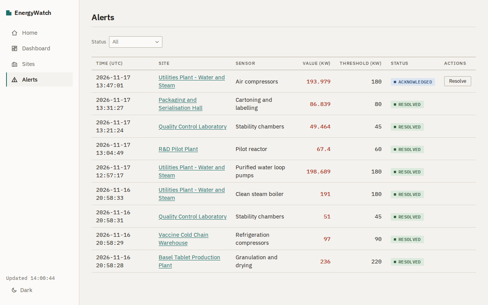
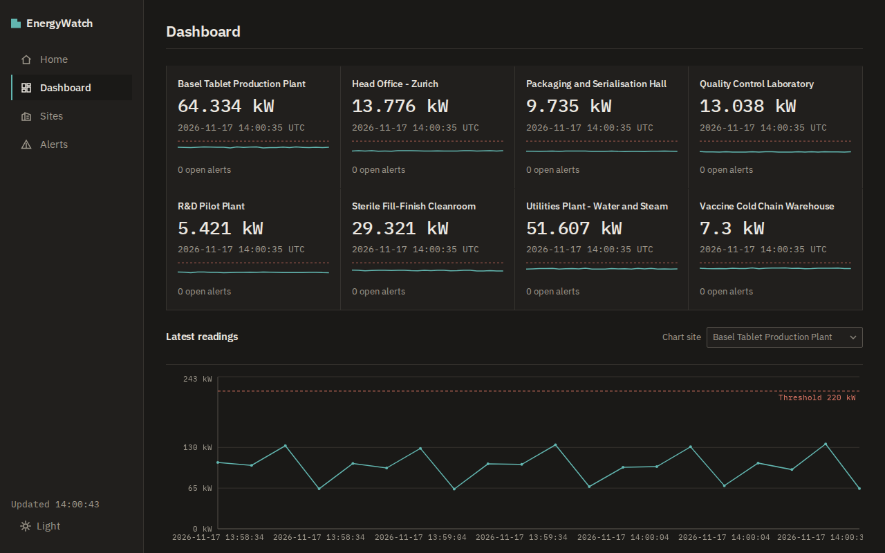
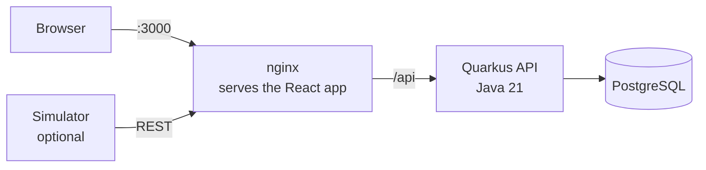

# EnergyWatch

Energy monitoring for a company with several sites. Sensors send power readings, the API compares every
reading with its site's limit, raises an **alert** the moment one goes over, and tracks that alert until
someone has dealt with it. A React dashboard shows what is happening, live.

The repository ships with a made-up **medicines manufacturer** as demo data (a tablet plant, a vaccine
cold chain, a sterile cleanroom, a QC lab...) and a simulator that keeps it moving, so the app is alive
the moment you start it. Nothing in the demo is real consumption.


## Quick start

You need Docker (with Compose) and, for the demo data, Python 3. Nothing else.

```bash
docker compose up -d --build        # database + API + web app
python3 scripts/seed_demo.py        # the demo factory: 8 sites, 29 sensors, 24 h of readings, a few alerts
docker compose --profile demo up -d # optional: a simulator sends new readings every 30 s
```

Open **http://localhost:3000**. Stop with `docker compose down` (add `-v` to also wipe the database).

## Screenshots

| Home | Alerts |
|---|---|
|  |  |

| A site: sensors and readings | Dark theme and phone layout |
|---|---|
|  |  |

<p align="center"></p>

## What it does

- **Sites and sensors.** A site is a place you monitor (a plant, a warehouse), with a power threshold in kW.
  A sensor is a meter inside a site.
- **Readings.** Sensors post readings (value in kW, time in UTC). Readings can be listed per site, filtered
  by time range, and are paginated.
- **Alerts.** A reading above its site's threshold raises an alert automatically. An alert moves
  **Open → Acknowledged → Resolved**, and a sensor never has two active alerts at once.
- **Dashboard.** One tile per site with its latest reading, a sparkline against its limit and its open
  alerts, plus a chart of recent readings with the threshold drawn on it. It refreshes every 30 seconds
  and flashes the value that changed.
- **Home page** with live system totals, light and dark themes (following the OS, with a manual toggle),
  and a layout that works from phone to wide monitor.

## How it fits together



| Part | Technology |
|---|---|
| Backend | Java 21, Quarkus, Hibernate ORM with Panache, Flyway migrations, PostgreSQL |
| Frontend | React, TypeScript, Vite, React Router, Axios, Recharts |
| Tests | JUnit 5 + RestAssured, Jest + React Testing Library, Playwright |
| Delivery | Docker Compose, GitHub Actions |

### API (base path `/api/v1`, JSON)

| Method and path | What it does |
|---|---|
| `GET /health` | Is the API up |
| `GET /sites`, `POST /sites` | List (paginated) and create sites |
| `GET /sites/{id}`, `PUT /sites/{id}` | Read and update one site |
| `GET /sites/{id}/sensors`, `POST /sites/{id}/sensors` | Sensors of a site |
| `GET /sensors/{id}` | One sensor |
| `POST /sensors/{id}/readings` | Send a reading (may raise an alert) |
| `GET /sites/{id}/readings?from=&to=&page=&size=` | Readings of a site, newest first |
| `GET /alerts?status=&page=&size=` | Alerts, newest first, with site and sensor names |
| `PATCH /alerts/{id}` | Acknowledge or resolve an alert |
| `GET /dashboard/summary?page=&size=` | One page of per-site tiles: latest reading, threshold, open alerts, trend |
| `GET /dashboard/overview` | System totals for the home page |

Conventions: `201` on create, `400` on invalid input, `404` when missing; records as request and response
objects (entities are never exposed); lists answer `{ items, page, size, total }`.

## Tests and checks

```bash
cd backend  && ./mvnw verify                 # unit and HTTP tests (needs Docker: a throw-away PostgreSQL)
cd frontend && npm run check                 # lint + type check + Jest
cd e2e      && npm run test:fresh            # Playwright against a throw-away stack with an empty database
python3 -m unittest discover -s scripts -v   # the demo simulator's decisions
```

`npm run test:fresh` builds a second copy of the stack on port 3100 with its database in memory, runs the
browser tests against it and tears it down, so it never touches the data of your running demo. The plain
`npx playwright test` in `e2e/` targets the dev stack on port 3000.

Every push is built and tested by GitHub Actions (backend, frontend and end-to-end jobs). The project was
built test-first: each feature starts with a failing test.

## Design decisions worth a look

- **No N+1 queries.** The alerts list and the dashboard load names, counts, latest readings and trends for a
  whole page with a fixed number of queries (`IN` lookups, `GROUP BY`, one window-function query).
- **No duplicate alerts under load.** Raising an alert locks the sensor row, and a partial unique index
  guarantees at most one active alert per sensor, so two simultaneous readings cannot both create one.
- **One error shape.** A catch-all mapper turns unexpected failures into a clean JSON `500` instead of a
  stack trace.
- **Pagination everywhere** with a default and a hard maximum; bad paging parameters give `400`.
- **All times are UTC**, stated on screen, so results never depend on the viewer's time zone.
- **Live without WebSockets.** Pages poll every 30 seconds, skip polling in a hidden tab, and keep the old
  data on screen if a refresh fails.
- **Accessible by default.** Semantic markup, labelled controls, status chips that say the status in words
  (never colour alone), visible focus, reduced-motion support.
- **Design.** A "control-room ledger" look: flat surfaces, hairline rules, tabular numerals, one accent colour
  and amber/blue/green reserved for alert states. Colours, spacing and fonts are CSS variables, so a theme is
  just another set of values.

## Repository layout

```
backend/    Quarkus API: site, sensor, reading, alert and dashboard packages, Flyway migrations (V1..V5)
frontend/   React app: pages, shared components, API modules, hooks, context
e2e/        Playwright tests and the throw-away stack setup
scripts/    seed_demo.py (demo data), simulate_readings.py (keeps it alive), shared model and tests
docs/       Screenshots and per-milestone notes
progress.md The project log: what was built, in what order, and why
```

## Limits

This is a practice project. There is **no authentication** (it was deliberately left out of scope), the
demo readings are simulated, and if the stack is switched off for hours the charts show a gap, because
nothing backfills missing readings.

## More

- [`progress.md`](progress.md): the full project log, including every decision and what was verified.
- [`docs/milestones/`](docs/milestones): the plan and notes for each milestone.
